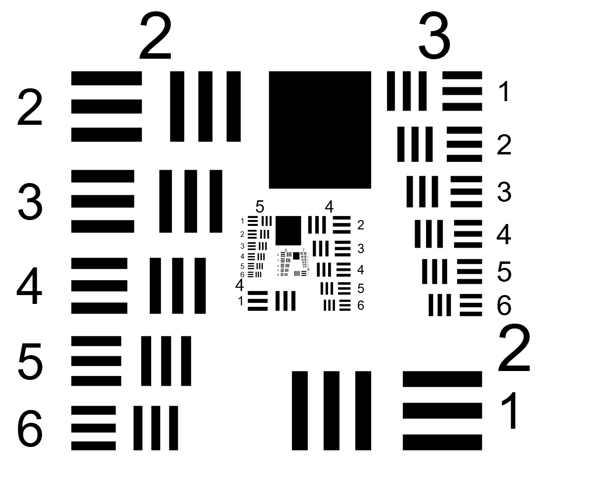

# USAF 1951 target generator

A Python script that generates an SVG of the **1951 USAF resolution test chart**. The bar dimensions follow **MIL-STD-150A**, and the layout reproduces the original 1951 chart. By default it draws groups 2 to 7 (4 to 228 lp/mm) at **true physical size**.



## Usage

Requires Python 3.6 or later. It uses only the standard library.

```sh
python usaf1951.py                                   # groups 2-7, true size -> usaf1951_groups2-7.svg
python usaf1951.py --scale 50                        # printed 50x larger (about 23 cm wide)
python usaf1951.py --negative                        # white pattern on black (like a glass slide)
python usaf1951.py --first-group -2 --last-group 7   # any even -> odd range of groups
python usaf1951.py --table                           # also print the lp/mm and line-width table
python usaf1951.py -o my_target.svg                  # choose the output file
```

The SVG is drawn in millimetres, so its `width` and `height` are the real size of the pattern multiplied by `--scale`. At true size, group 2 element 1 has 125 µm lines and group 7 element 6 has 2.19 µm lines. A printer cannot reproduce the finest groups at that size. To use the target as a printed chart, enlarge it with `--scale` and divide the frequencies by the scale factor.

## Bar geometry (MIL-STD-150A)

The bar geometry follows MIL-STD-150A (12 May 1959), §5.1.1.7 and Figure 7:

| quantity | value |
|---|---|
| resolution | R = 2^(group + (element − 1)/6) lp/mm |
| line width and space width | w = 1 / (2R) mm |
| line length | 5w |
| gap between the two patterns | 2w (= 1/R) |

Each element has three vertical and three horizontal lines. Each element is 2^(1/6) (about 12 %) finer than the previous one.

| group | element 1 | element 6 |
|---|---|---|
| 2 | 4.00 lp/mm, 125.0 µm | 7.13 lp/mm, 70.2 µm |
| 3 | 8.00 lp/mm, 62.5 µm | 14.25 lp/mm, 35.1 µm |
| 4 | 16.00 lp/mm, 31.3 µm | 28.51 lp/mm, 17.5 µm |
| 5 | 32.00 lp/mm, 15.6 µm | 57.02 lp/mm, 8.8 µm |
| 6 | 64.00 lp/mm, 7.8 µm | 114.04 lp/mm, 4.4 µm |
| 7 | 128.00 lp/mm, 3.9 µm | 228.07 lp/mm, 2.2 µm |

Run `python usaf1951.py --table` for all elements.

## Layout

MIL-STD-150A defines only the element. It does not give dimensions for how the elements are arranged. The arrangement used here reproduces the original 1951 chart made by Buckbee-Mears Co., measured from a scan of a physical target:

- **Layers:** each layer holds an even group G and the odd group G+1. Elements 2–6 of G run down the outer column. Element 1 of G sits in the bottom corner, with the group number repeated next to it. Elements 1–6 of G+1 run down the inner column.
- **Nesting:** the next layer (G+2, G+3) is a quarter-scale copy, mirrored left to right, nested under the reference square. Layers starting at groups −2, 2 and 6 are drawn normally; layers starting at 0, 4 and 8 are mirrored, as on the original chart.
- **Labels:** element and group numbers sit on the outer side of each column.
- **Reference square:** each layer has one. On the original chart it is slightly taller than wide, about 6.45 × 7.42 line widths of the layer's element 1.

Commercial targets vary in these details. For example, Applied Image's T-20 uses a square with an edge equal to the line length of element 2. These variations have no effect on the resolution measurement.

The digits are SVG text in Arial/Helvetica, so their exact shape depends on the fonts installed where the file is viewed. The bars are exact.

## Verification

`verify_svg.py` reads a generated SVG back and checks every bar against MIL-STD-150A: line width, length, line spacing, alignment of the two patterns, and the 2w gap between them. It also checks that no shapes overlap.

```sh
python verify_svg.py usaf1951_groups2-7.svg 2 7
```

The layout was compared with a scan of the original 1951 chart. Every feature checked (reference square, columns, bottom element, nested layer) is within 0.2 line widths of the original, which is within the precision of the scan.

## References

- MIL-STD-150A, *Photographic Lenses*, 12 May 1959 — [scanned copy](https://circuitousroot.com/oldstuff/library-of-antiquarian-technology/optics/mil-std-150a/index.html), [EverySpec listing](https://everyspec.com/MIL-STD/MIL-STD-0100-0299/MIL-STD-150A_16197/)
- [1951 USAF resolution test chart — Wikipedia](https://en.wikipedia.org/wiki/1951_USAF_resolution_test_chart)
- [Applied Image T-20 USAF 1951 chart specification](https://www.appliedimage.com/wp-content/uploads/2017/09/USAF-1951-Test-Target-T-20_v1-04.pdf)
- E. F. Glynn, [*USAF 1951 and Microcopy Resolution Test Charts*](https://sites.astro.caltech.edu/~lah/ay105/pdf/e2-usaf1951.pdf)

This is an independent project and is not affiliated with or endorsed by the U.S. Air Force.

## License

MIT, see [LICENSE](LICENSE).
